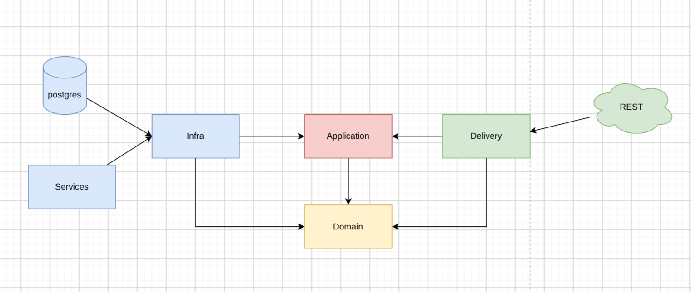

The purpose of this project are:

- Learned Clean Architecture in Go
- Communicate multiple services
- Basic order processing 
- Integrated payment gateway (Midtrans)

##### Todo

- [ ] Unit Test
- [ ] API Gateway 
- [ ] gRPC (for communication between services)
- [ ] Observability: Prometheus, Otel, Jaeger, and etc.
- [ ] Outbox Pattern


##### Tech stack
- Go
- Gin (web framework)
- Rabbitmq

---

##### Clean Architecture

Clean Architecture is a software design that seperates an application into layers. The architecture produces systems that are:

- **Independent of framework**. The architecture doesn't depend on the existence of some library of feature laden software. This allows you to use such frameworks as tools, rather than having to cram your system into limited constraints.
- **Testable**. The business rule can be tested without UI, Database, Web Server, or any other external element.
- **Independent of UI**. The UI can change easily, without changing the rest of the system. A web UI could be replaced with a console UI, for example, without changing the business rules.
- **Independent of Database**. You can swap out Oracle, or SQL Server, for Mongo, BigTable, CouchDB, or somehting else.
- **Independent of any external agency**. In fact your business rules simply don't know anything at all about outside the world.

**The Dependency Rule**

This rule says that source code dependency can only point *inward*.

For example, the *application* layer can import code from the *domain* layer, but the *domain* layer can't import code from *application* layer.

*Note*
```md
if you import code from the *application* into the *domain* layer, the *domain* layer would be depend on the *application* layer. It violate the rule of the dependency rule
```

##### Project Layers

In this project has 4 layers:



- **Application**: this layer contains application business rules.
- **Domain**: this layer contains enterprise business rules.
- **Infra**: this layer contains implementation details for external tools and services, such as database, message broker, and third-party APIs.
- **Delivery**: this layer handle communication between application and outside world.

source:
- https://blog.cleancoder.com/uncle-bob/2011/11/22/Clean-Architecture.html
- https://github.com/bxcodec/go-clean-arch


